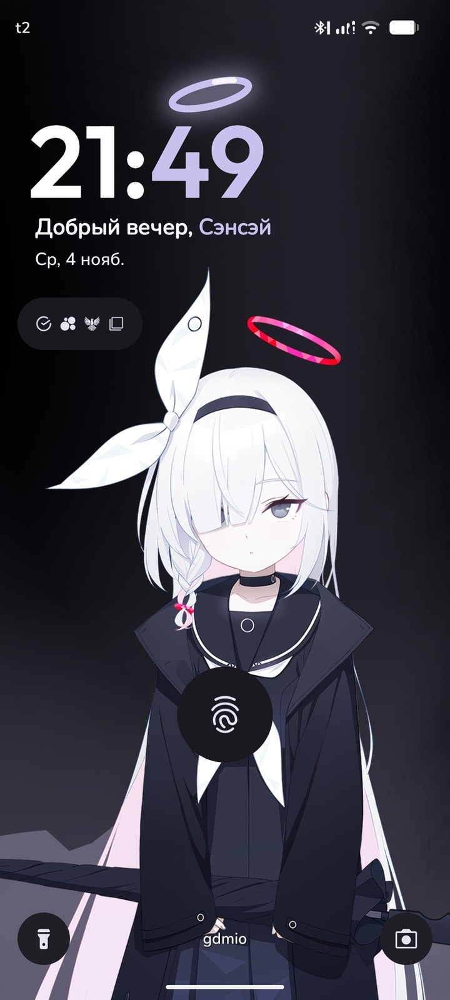
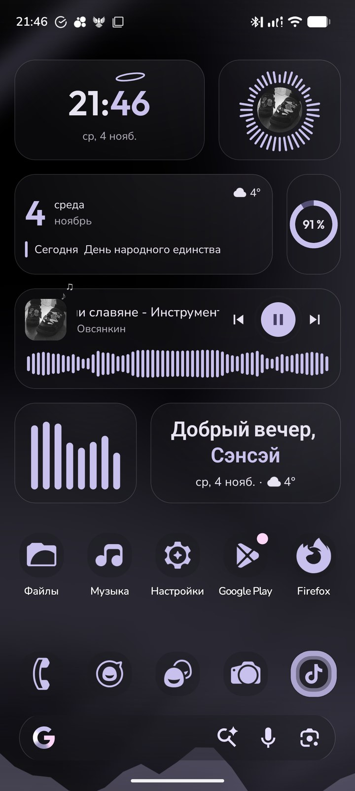
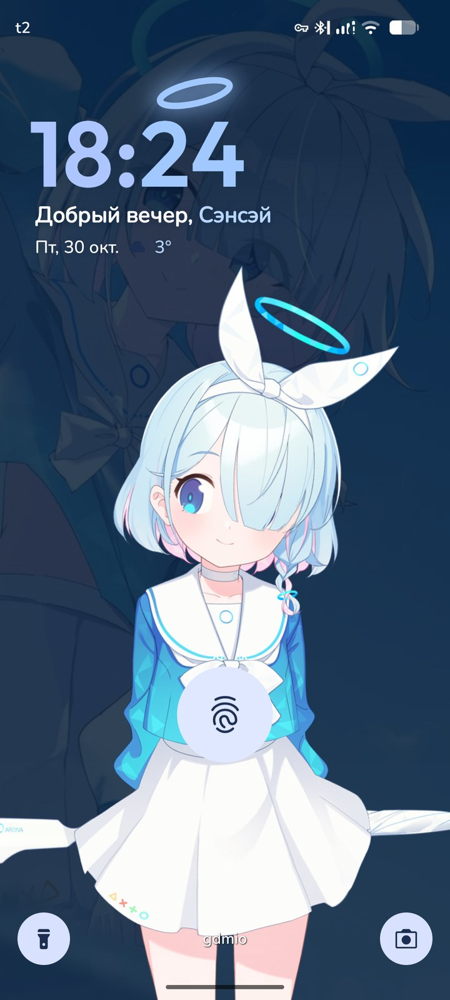
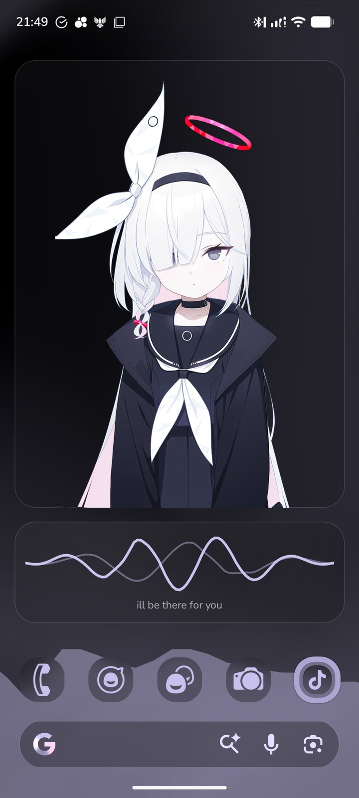
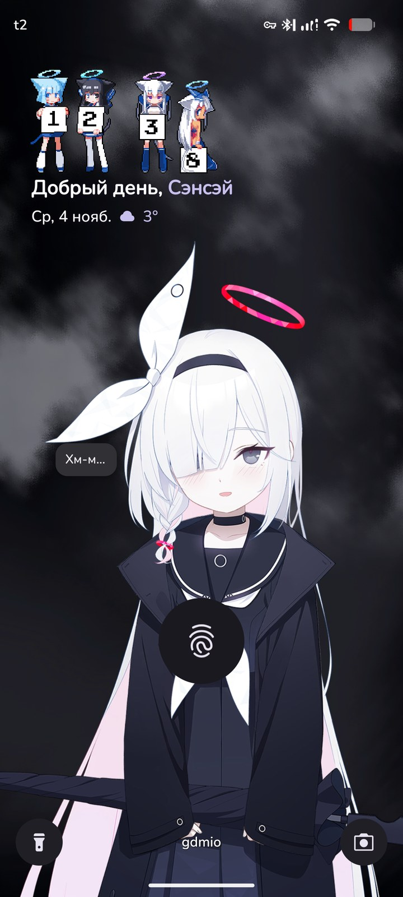
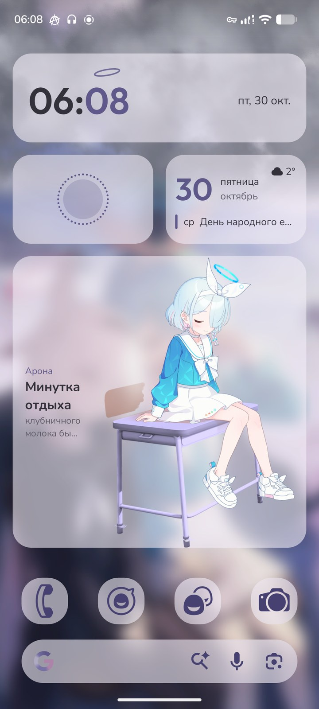
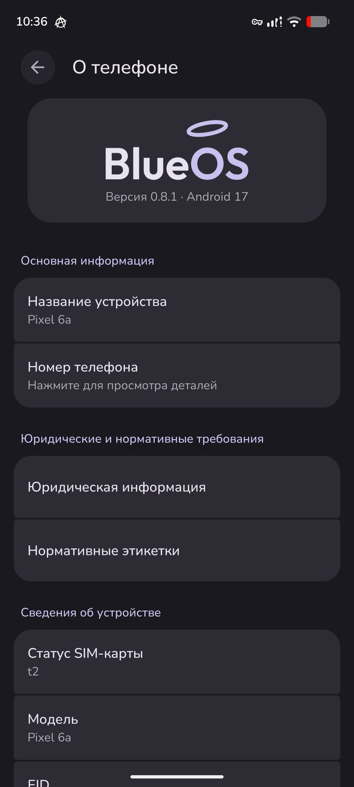

# BlueOS

Фанатская прошивка на основе **LineageOS 24.0 (Android 17)**, вдохновлённая **Blue Archive**: свой логотип и анимация
загрузки, живой нимб на часах экрана блокировки, живые виджеты, «Цвета» (каждая деталь берёт цвет из обоев по своей
роли), живая погода и эквалайзер прямо на обоях, живой персонаж на экране блокировки и в виджете — Арона или Плана
(нужны свои файлы, см. ниже).

Разрабатывается на **Google Pixel 6a (`bluejay`)**. Под другие телефоны BlueOS можно собрать самому — эти исходники
для этого и выложены — или попробовать экспериментальный GSI ([GSI.md](GSI.md)).

📣 **Новости и новые версии: Telegram-канал [t.me/BlueOSfirmware](https://t.me/BlueOSfirmware).**

> BlueOS — неофициальный фанатский проект. Он не связан с Nexon, Yostar и NEXON Games. **Файлов из игры здесь нет**:
> модели персонажей, их голоса, музыка, звуки и обои из игры не входят в исходники. Без них прошивка полностью
> работает, просто без персонажа и этих звуков. Файлы игры можно добавить **прямо на телефоне**, без сборки:
> «Обои и стиль» → «Персонаж» → «Добавить файлы персонажа» ([ASSETS.md](ASSETS.md)). Где их взять: ссылка в описании
> профиля автора в TikTok — [tiktok.com/@chozadaun](https://www.tiktok.com/@chozadaun).

> ⚠️ **Без гарантий.** Установка любой прошивки стирает телефон и требует разблокированного загрузчика; часть
> приложений (оплата телефоном, некоторые банки) может не работать. Всё — на ваш страх и риск. Подробно —
> [INSTALL.md](INSTALL.md), раздел «Прочитайте до начала».

## Как это выглядит
<table>
<tr>
<td align="center" width="25%"> Плана и живые часы*</td>
<td align="center" width="25%"> Виджеты и эквалайзер</td>
<td align="center" width="25%"> Арона на экране блокировки*</td>
<td align="center" width="25%"> Плана в виджете*</td>
</tr>
<tr>
<td align="center" width="25%"> Пиксельные часы Moe*</td>
<td align="center" width="25%"> Арона за партой*</td>
<td align="center" width="25%"> О телефоне</td>
</tr>
</table>

* Персонажи и их голоса появляются, только если добавить свои файлы. В прошивку они не входят, как и обои с этих скриншотов (кроме стандартных LineageOS). Снято на Pixel 6a.

## С чего начать
| Что нужно | Где |
|---|---|
| **Поставить готовую BlueOS на Pixel 6a** | **Releases** + [INSTALL.md](INSTALL.md) |
| **Попробовать на другом телефоне** (GSI, экспериментально, проверен только на Pixel 6a) | **Releases** + [GSI.md](GSI.md) |
| Собрать BlueOS под свой телефон | [BUILDING.md](BUILDING.md) |
| Телефона нет в списке / что подстроить под другой экран | [PORTING.md](PORTING.md) |
| Вернуть персонажа и звуки (на телефоне, без сборки) | [ASSETS.md](ASSETS.md) |
| Собирать с помощью ИИ-агента (Claude Code и др.) | [AGENTS.md](AGENTS.md) |

**Проще всего — с агентом.** Откройте папку с исходниками LineageOS в Claude Code (или другом агенте, который
читает `AGENTS.md`) и скажите: «собери BlueOS для моего телефона». В `AGENTS.md` описано, что ему проверить,
в каком порядке делать и где обычно ломается.

## Что внутри
- `config/blueos.mk` — всё подключение BlueOS (одна строка в `vendor/extra/product.mk`).
- `patches/<проект>/*.patch` — изменения кода LineageOS/AOSP: SystemUI, лаунчер, «Обои и стиль», Настройки,
  Часы, Календарь, Галерея, recovery. Ставятся сами при `source build/envsetup.sh`.
- `libs/arona` — общая библиотека: настройки BlueOS, роли цветов, движение телефона, погода, персонажи.
- `overlay/` — ресурсы поверх стоковых (названия, значения по умолчанию), `fonts/`, `media/` (логотип,
  анимации загрузки), `sepolicy/`, `tools/` (скрипты, которыми сделаны логотип, анимации, шрифты, часы Moe).

## Лицензии
- Код BlueOS (патчи, `libs`, `tools`, `config`, `overlay`) — Apache License 2.0, как LineageOS ([LICENSE](LICENSE)).
- Шрифты в `fonts/` — SIL Open Font License (файлы `OFL.txt` рядом).
- Цифры часов Moe — проект [Moe-Counter](https://github.com/journey-ad/Moe-Counter), MIT (`media/moe/src/LICENSE-Moe-Counter`).
- `prebuilts/spine` — [Spine Runtimes](https://esotericsoftware.com/spine-runtimes-license) (Esoteric Software):
  по их лицензии каждому, кто использует рантайм Spine, нужна своя лицензия Spine Editor. Подробнее — [NOTICE.md](NOTICE.md).

---

## English

**BlueOS** is a fan-made Android ROM based on **LineageOS 24.0 (Android 17)**, inspired by *Blue Archive*: own boot
animation and logo, a live halo lock-screen clock, live widgets, colour roles from the wallpaper, live weather and a
music equalizer drawn on the wallpaper, and a live character on the lock screen and in a widget.

Screenshots are [at the top of this page](#как-это-выглядит) (the characters and most wallpapers there are the author's own files and are not included in the ROM).

It is developed on the Google Pixel 6a (`bluejay`); these sources let you build it for any device that LineageOS
24.0 supports. **No game files are included** — BlueOS is unofficial and not affiliated with Nexon / Yostar; it works
fully without them (no character and no game sounds). Game files can be added on the phone, no build needed:
Wallpaper & style → Character → Add character files ([ASSETS.md](ASSETS.md)). Where to get them: the link in the
author's TikTok profile description, [tiktok.com/@chozadaun](https://www.tiktok.com/@chozadaun).

**No warranty — flashing wipes the phone; use at your own risk.** A ready-made build for the Pixel 6a is under
**Releases** ([INSTALL.md](INSTALL.md)), and an experimental GSI for other phones, tested only on a Pixel 6a ([GSI.md](GSI.md)). Start with [BUILDING.md](BUILDING.md) (build), [PORTING.md](PORTING.md) (other devices), [AGENTS.md](AGENTS.md)
(let an AI coding agent such as Claude Code walk you through it). The guides are in Russian; the commands are the same.
